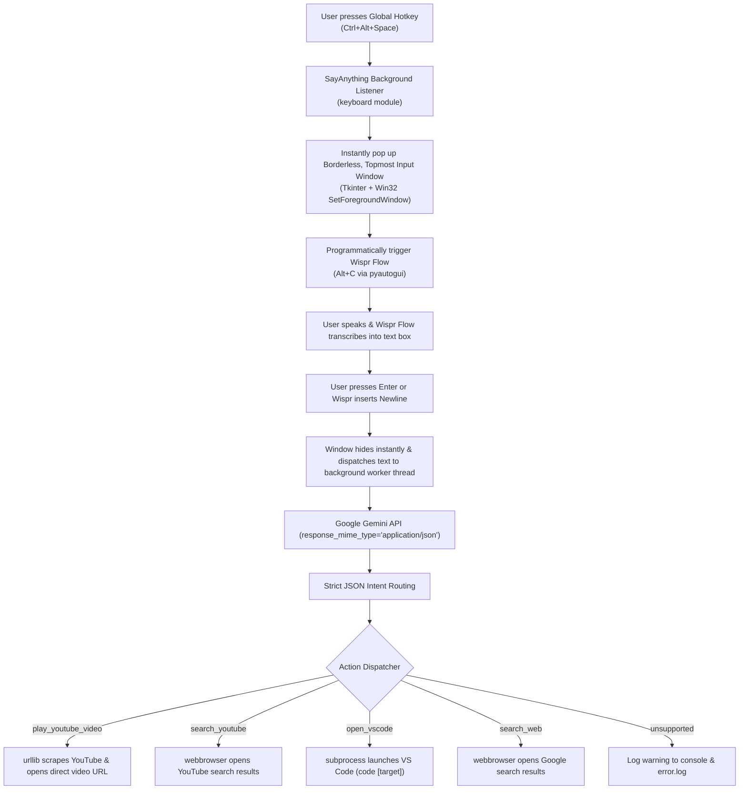

# 🎙️ SayAnything: Voice-Controlled OS Automation for Windows

A robust, ultra-fast, and bug-free Windows OS Voice Automation application powered by **Wispr Flow** for voice dictation and the **Google Gemini API** (`google-generativeai`) for structured intent classification.

---

## 🏗️ Architecture & Workflow

---

## ✨ Features

- **Global Hotkey Trigger (`Ctrl+Alt+Space`)**: Runs in the background and activates instantly from anywhere in Windows.
- **Raycast/Spotlight-Style Floating Bar**: Custom dark-mode borderless modal with vibrant accent glow, always-on-top, and forced foreground focus.
- **Hands-Free Wispr Flow Integration**: Programmatically triggers Wispr Flow (`Alt+C` by default) immediately upon bar activation so you can speak right away.
- **Structured JSON Intent Engine**: Strictly configured via Gemini's `response_mime_type="application/json"` with zero markdown formatting errors.
- **Direct Video Auto-Player**: Scrapes YouTube via `urllib` to find the exact top video and immediately opens the watch URL (`https://www.youtube.com/watch?v=...`).
- **Resilient Multi-Threaded Design**: Network calls and Gemini requests run on worker threads so the GUI never freezes.
- **Robust Error Logging**: Comprehensive `try/except` guards around every operation. Errors and stack traces are logged to `error.log` without crashing the daemon.
- **Graceful Termination (`Ctrl+Shift+Q`)**: Clean unhooking of global keyboard hooks and UI teardown.
