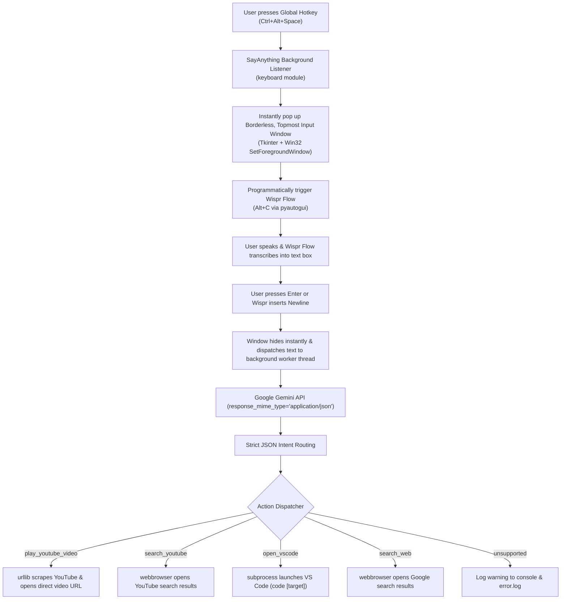

# 🎙️ SayAnything: Voice-Controlled OS Automation for Windows

A robust, ultra-fast, and bug-free Windows OS Voice Automation application powered by **Wispr Flow** for voice dictation and the **Google Gemini API** (`google-generativeai`) for structured intent classification.

---

## 🏗️ Architecture & Workflow



---

## ✨ Features

- **Global Hotkey Trigger (`Ctrl+Alt+Space`)**: Runs in the background and activates instantly from anywhere in Windows.
- **Raycast/Spotlight-Style Floating Bar**: Custom dark-mode borderless modal with vibrant accent glow, always-on-top, and forced foreground focus.
- **Hands-Free Wispr Flow Integration**: Programmatically triggers Wispr Flow (`Alt+C` by default) immediately upon bar activation so you can speak right away.
- **Structured JSON Intent Engine**: Strictly configured via Gemini's `response_mime_type="application/json"` with zero markdown formatting errors.
- **Direct Video Auto-Player**: Scrapes YouTube via `urllib` to find the exact top video and immediately opens the watch URL (`https://www.youtube.com/watch?v=...`).
- **Resilient Multi-Threaded Design**: Network calls and Gemini requests run on worker threads so the GUI never freezes.
- **Robust Error Logging**: Comprehensive `try/except` guards around every operation. Errors and stack traces are logged to `error.log` without crashing the daemon.
- **Graceful Termination (`Ctrl+Shift+Q`)**: Clean unhooking of global keyboard hooks and UI teardown.

---

## 📋 System Requirements

- **Operating System**: Windows 10 or Windows 11
- **Python**: Python 3.10, 3.11, 3.12, 3.13, or 3.14
- **Wispr Flow**: Installed and running (set to toggle mode or your preferred shortcut)
- **Visual Studio Code**: Optional (make sure `code` is in your Windows system PATH)

---

## 🚀 Quick Start Guide

### 1. Clone or Open the Repository
```powershell
cd f:\SayAnything
```

### 2. Install Required Packages
```powershell
pip install -r requirements.txt
```

### 3. Configure Your `.env` File
Copy `.env.example` to `.env`:
```powershell
copy .env.example .env
```

Open `.env` in your text editor and add your **Gemini API Key**:
```env
# Google Gemini API Key (Get free key from https://aistudio.google.com/)
GEMINI_API_KEY=AIzaSyYourActualKeyHere

# Model to use (gemini-1.5-flash or gemini-2.0-flash)
GEMINI_MODEL=gemini-1.5-flash

# Global hotkey to open the voice bar
TRIGGER_HOTKEY=ctrl+alt+space

# Shortcut configured inside Wispr Flow settings to toggle dictation
WISPR_HOTKEY=alt+c

# Exit hotkey to cleanly stop the background app
EXIT_HOTKEY=ctrl+shift+q

# Auto trigger Wispr when input bar pops up (true/false)
AUTO_TRIGGER_WISPR=true

# VS Code executable command
VSCODE_COMMAND=code
```

> [!TIP]
> If your Wispr Flow shortcut is different (e.g. `Win+Shift+D` or `Ctrl+Alt+W`), simply change `WISPR_HOTKEY` in `.env` to match your Wispr settings.

---

## 🎮 How to Run

### Option A: Standard Run (With Console Output)
Recommended for initial testing and viewing live logs:
```powershell
python main.py
```

### Option B: Silent Background Mode (No Console Window)
To run SayAnything silently in the background:
```powershell
pythonw main.py
```
To stop the silent background process at any time, simply press **`Ctrl+Shift+Q`** or end the `pythonw.exe` process in Windows Task Manager.

### Option C: Run as Administrator (Optional but Recommended)
On Windows, global keyboard hooks cannot intercept keystrokes when an Administrator/Elevated window (like an Admin PowerShell or Task Manager) is focused unless your script is also run as Administrator.
If you notice the hotkey not triggering while inside elevated windows, right-click your terminal and select **"Run as Administrator"**, then run `python main.py`.

---

## 🗣️ Voice Commands & Examples

| Voice Command | Parsed Action | Execution Result |
| :--- | :--- | :--- |
| *"Play Bohemian Rhapsody"* | `play_youtube_video` | Finds top YouTube match and opens `https://www.youtube.com/watch?v=...` |
| *"Play lofi beats to study to"* | `play_youtube_video` | Auto-plays top lofi video directly |
| *"Search YouTube for Python automation"* | `search_youtube` | Opens YouTube search results page for "Python automation" |
| *"Open VS Code in my project"* | `open_vscode` | Launches `code "my project"` |
| *"Open VS Code"* | `open_vscode` | Launches Visual Studio Code |
| *"Search the web for best mechanical keyboards"* | `search_web` | Opens Google search in default browser |
| *"What is the distance to Mars?"* | `search_web` | Searches Google for the question |

---

## 📁 Project Structure

```
f:\SayAnything\
├── .env.example          # Environment variables template
├── .env                  # Your local secrets (API keys, hotkeys)
├── requirements.txt      # Python dependencies
├── config.py             # Centralized settings and UI theme constants
├── logger.py             # Thread-safe dual logging (Console + error.log)
├── gemini_parser.py      # Structured JSON intent routing with google-generativeai
├── executor.py           # Actions: YouTube direct play, search, VS Code, Google
├── ui.py                 # Borderless, topmost dark modal with Wispr auto-trigger
├── main.py               # Application entry point, global hotkeys, worker threads
└── README.md             # Documentation and usage instructions
```

---

## 🛡️ Error Handling & Logs

- If your Gemini API key is missing or invalid, an alert is recorded in `error.log` and displayed in the console without crashing the application.
- If YouTube structure changes or network is down, `play_youtube_video` automatically falls back to opening YouTube's standard search page.
- All unhandled exceptions are caught and written to `error.log` with complete tracebacks.
